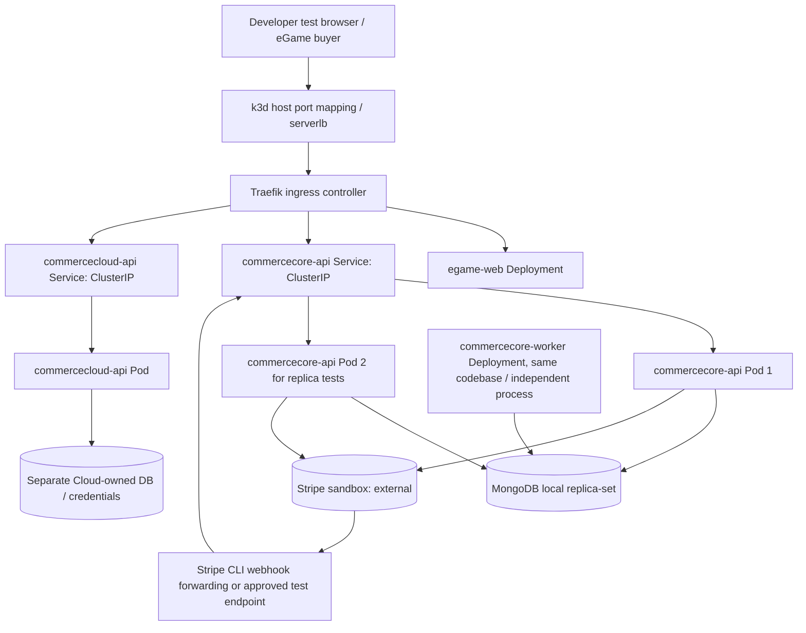

# M01 — Kubernetes-First Local Architecture Proposal

**State:** PROPOSED — USER RATIFICATION REQUIRED. **Owner:** @sergio-tr. **Date:** 2026-10-30. **Purpose:** bring local Kubernetes delivery foundations into M01 without silently changing M08 or the accepted modular-monolith/domain decisions. **Code implementation:** NOT STARTED.

## Existing authoritative baseline versus new proposal

Historical baseline: M01 = Nx/pnpm + NestJS modular CommerceCore + Angular reference shell, CI, ports/adapters, docs-as-code, reproducible local tooling; M07 = mandatory bounded-context microservice extraction; M08 = advanced Kubernetes/operations verification. CommerceCore is headless and reusable, CommerceCloud independent SaaS/control plane, eGame first consumer. No application code exists in the current project root (documentation and .github only, checked 2026-10-30). These facts are source-backed.

**New proposed scope change:** include a real but simple **local k3d/K3s Kubernetes cluster, independent Deployments, ClusterIP Services, an entry load balancer and ingress routing, container builds and health/rollout tests in M01**. Keep advanced Gateway API migration, GitOps, Terraform, secret controllers, Kafka operators, cluster HA, chaos/network failure, HPA and full telemetry pipelines in M08 or later, unless individually authorized.

## Options

| Option | Meaning | Benefits | Costs / risk | Recommendation |
|---|---|---|---|---|
| K1 — Docker Compose first, Kubernetes only M08 | Original lighter startup | Fast app feedback | Does not satisfy user's desire to learn Kubernetes from day one | Do not choose as primary |
| K2 — k3d local, several deployments, simple ingress and services from M01 | Kubernetes-native learning with bounded complexity | Real Kubernetes scheduling, rolling rollout, Service balance and isolation | More setup/resource work than Compose | **RECOMMENDED** |
| K3 — Full multi-cluster / production-like platform, service mesh, GitOps and advanced Gateway from M01 | Max orchestration features | High operations burden, risks distracting from DDD/financial safety | Defer |

### Recommended deployment topology (logical, not currently running)

The drawing shows **proposed components** and future paths. Authentication and secrets are omitted for diagram simplicity and MUST be designed before exposing privileged endpoints. A Kubernetes Deployment is a runtime unit, not automatically a separate bounded context or microservice.

### First M01 physical workload recommendation

| Workload | Runtime and exposure | Initial replica goal | Status |
|---|---|---|---|
| `egame-web` | Angular build served as static web; routed externally | 1 (2 later for scale exercise) | Proposed, no actual application |
| `commercecore-api` | NestJS HTTP composition root containing multiple domain modules | 1 for bootstrap, **2 for load-balance verification** only | Proposed |
| `commercecloud-api` | Independent NestJS control plane, separately owned persistence/credentials | 1 | Proposed |
| `commercecore-worker` | Independent process/Deployment using versioned Outbox + recovery jobs | 1 initially; competing workers only with idempotence tests | Proposed; no financial sends |
| `mongodb` | StatefulSet or controlled local replica-set with persistent volume | 1 replica-set member for transaction development (NOT HA) | Infrastructure proposal |
| `identity` | Keycloak or equivalent auth provider | Add after M00.3 authority/session design | No premature exposed admin |
| `kafka` | Event transport | M05 only | NOT M01 |
| `ingress` | Traefik shipped with k3s/k3d for HTTP routing | Managed cluster component | Initial recommendation |

**Database note:** cloud and core may initially share one Mongo *infrastructure server* with separate databases, users and owned schemas, provided neither application accesses the other's data. Independent *data authority* is mandatory; separate Mongo deployments can come later. For M00.1, persistence guarantees and error behavior remain independently gated.

## Kubernetes networking: three different layers

1. k3d commonly runs an external Nginx **serverlb** container that maps host ports to cluster nodes. This is **local-cluster entry plumbing**, not a cloud-managed production load balancer.
2. Traefik **Ingress** routes external HTTP(S) host/path traffic toward the appropriate internal Service; this requires a controller. Kubernetes currently recommends Gateway API as successor to frozen Ingress API, but Ingress is supported and adequate for this introductory lab.
3. Kubernetes **ClusterIP Service** provides stable DNS/endpoint selection for multiple API Pods. Two healthy replicas and a Service demonstrate app-level load distribution; prove it with hostname/pod-ID responses and kill/restart tests.

For an actual `type: LoadBalancer` Service outside a cloud, a local implementation such as MetalLB or k3d's exposure plumbing is necessary; writing `type: LoadBalancer` is not by itself a guarantee of an address. **Recommended initial exercise:** k3d serverlb + Traefik Ingress + ClusterIP Services; advanced Gateway API in M08.

## Local developer environment proposal

- Windows host + WSL2/Linux workspace + Docker Desktop with WSL integration (verify installed versions rather than assume local state), or a native Linux machine.
- k3d + kubectl + Helm, version-pinned in a validated toolchain matrix before creating the cluster.
- pnpm/Nx/TypeScript/NestJS/Angular versions pinned together after checking current peer compatibility. Node 24 was a historical *candidate*, not a tested build.
- No paid cloud. All Kubernetes resources and Stripe sandbox credentials are for a disposable local environment; no unapproved remote deployment.
- Namespace split candidate: `commerce-apps` and `commerce-infra`. Kubernetes namespaces alone are NOT tenant isolation or network security.
- Use configuration validation, Kubernetes Secrets sourced from ignored local secrets; base64 alone is not encryption. No payment test keys or digital activation keys committed to Git.
- Resource quotas, health/readiness/liveness probes, persistent Mongo volumes, a defined `make down`/cluster delete workflow and a disaster-free reset fixture plan are M01 contract obligations.

## M01 Kubernetes success evidence

- A pinned toolchain from a clean clone can create/destroy the local cluster deterministically.
- At least one nonfinancial NestJS health endpoint starts as a Deployment with 2 API replicas, is reachable through the ingress and stable ClusterIP Service, and shows distinct replica identities for successive requests.
- Killing one Pod maintains HTTP availability through a ready peer; scaling a Deployment from 1 to 2 changes endpoints. These tests do not prove business idempotence.
- `egame-web` (static placeholder permitted after implementation authorization) and a separate CommerceCloud health deployment route independently.
- Restarting Mongo preserves a documented test fixture under a PVC; **this is not multi-node HA or Mongo failover evidence**.
- CI checks lint/typecheck/unit/module-import constraints; manifests/Helm templates render correctly and are reviewed; real test results with logs and version digests are attached.
- A bounded resource usage / cleanup test proves no paid cloud service was deployed.

## Changes NOT approved by this proposal

No microservice extraction before M07; no new Kafka financial guarantee; no Stripe account/keys created; no code, cluster or package installation; no passing readiness gate asserted. A user review must accept K2 and the routing, persistence and resource defaults. Once ratified, write individually testable M01 G3 issues and explicitly authorize G4 implementation.
